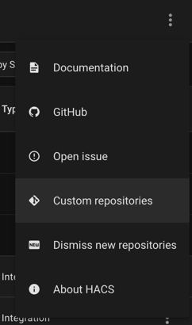
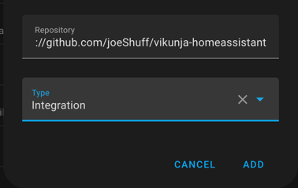
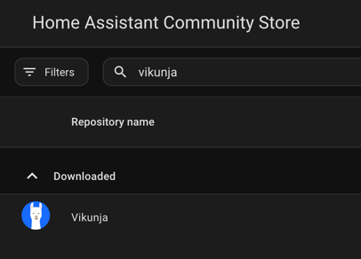
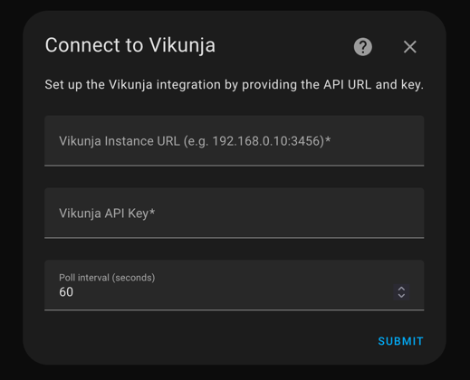
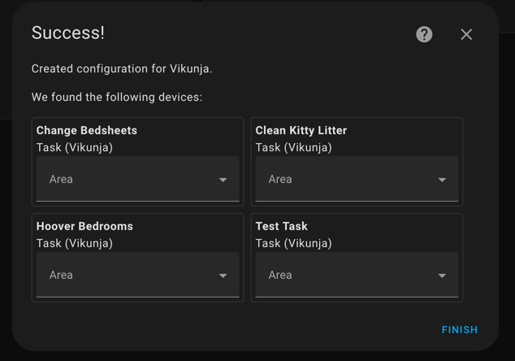
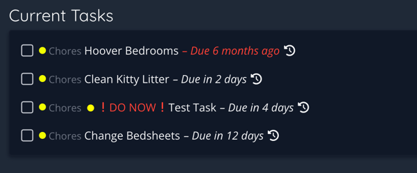
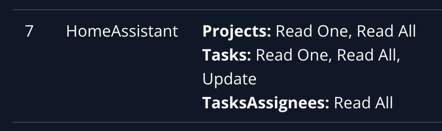
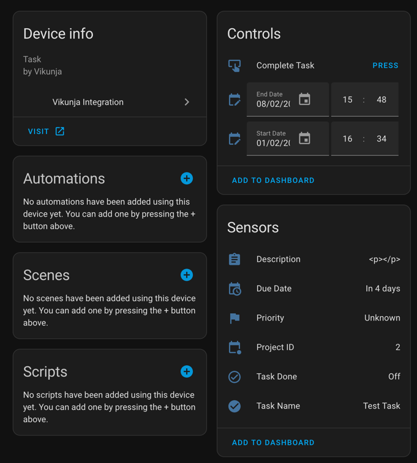
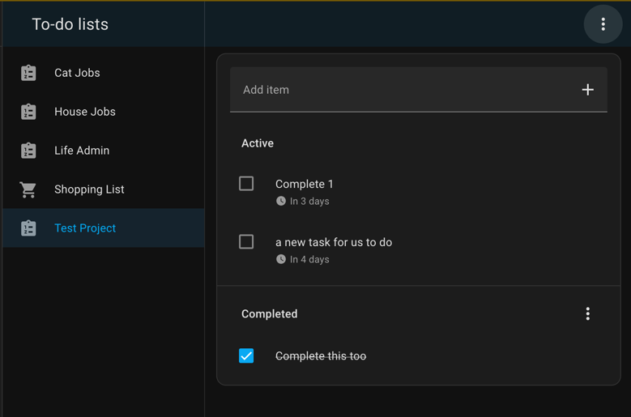
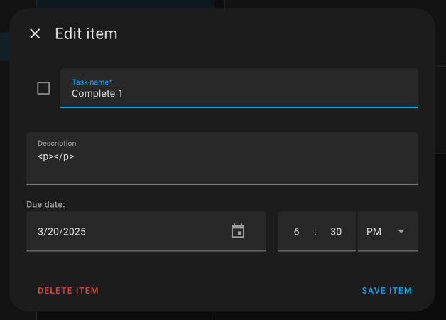

# Vikunja Home Assistant Integration

This Home Assistant integration allows you to sync tasks from your [Vikunja](https://vikunja.io/) instance to Home Assistant. You can view and manage tasks as entities and sensors within the Home Assistant UI.

[](https://my.home-assistant.io/redirect/config_flow_start/?domain=vikunja)

## Features

- Fetch tasks from Vikunja and display them as entities in Home Assistant
- Supports viewing and completing tasks. (more to come)
- Easy integration with Home Assistant UI for task management
- Actions to create, update and remove tasks, including labels, assignees and priority

## Installation

### Option 1: Install via HACS (Home Assistant Community Store)

#### Add Repository

1. Open HACS. Click the ... in the top right and "Custom Repositories" 



2. Add the link to this repository and select "Integration" from the dropdown.



3. Then install Vikunja integration.



#### Install Integration

1. Open Home Assistant and go to **Settings** > **Integrations**.
2. Click the **+** icon in the bottom right corner to add an integration.
3. Search for **Vikunja** in the list and select it.
4. Follow the prompts to complete the installation.

### Option 2: Manual Installation

1. Download the integration repository from GitHub.
2. Place the `custom_components/vikunja` folder inside the `custom_components/` directory in your Home Assistant configuration folder.
   - The folder structure should look like this:
     ```
     homeassistant/
     └── custom_components/
         └── vikunja/
     ```
3. Restart Home Assistant.

## Configuration

Once the integration is installed, you need to provide your Vikunja instance's URL and API key.

### API Key

1. Go to your Vikunja instance at [https://vikunja.io/](https://vikunja.io/) or your self-hosted Vikunja.
2. Log in to your account.
3. Navigate to the **API Keys** section in your Vikunja user settings.
4. Create a new API key. Giving some subset of access:
   - An expiration you'd prefer. I set mine to 10 years.
   - Projects (the integration fetches projects first, then tasks for projects)
     - Read All
     - Read One
   - Tasks
     - Create (optional if you want to create more via Todo)
     - Delete (optional if you want to delete via Todo)
     - Read All (required)
     - Read One (required)
     - Update (required)
   - Optional, for labels and assignees in the [actions](#actions):
     - Projects: Project Users (`projectusers`) for assignees
     - Labels: Read All
     - Task Labels (`tasks_labels`): Read All, Create, Delete, Update Bulk
     - Task Assignees (`tasks_assignees`): Read All, Create, Delete, Update Bulk
5. Copy the generated API key.

### Setup

This integration can be setup from the UI, so simply go to "Devices" -> "Add integration" and search for Vikunja.

Or use this button:




[](https://my.home-assistant.io/redirect/config_flow_start/?domain=vikunja)

### Permissions

The API key needs permission to read and update tasks. This allows Home Assistant to fetch and update task data. Ensure that the key has sufficient privileges for accessing the task-related endpoints.

These are the permissions I have that work:



### Usage
After successfully setting up the integration, Vikunja tasks will automatically appear as sensors and entities in Home Assistant. You can view their status, modify task attributes, and automate based on task data.



You will also find that each "Project" in Vikunja has created a Todo List in HA.



And you can Create/Update/Complete tasks from the Todo section


### Actions

Besides the standard `todo.*` actions, the integration provides actions for Vikunja features that Home Assistant's to-do lists don't support. They target a Vikunja to-do list, which selects the Vikunja project.

**`vikunja.create_task`** creates a task:

```yaml
action: vikunja.create_task
target:
  entity_id: todo.household
data:
  title: "Take out the bins"
  description: "Blue bin this week"    # optional
  due_datetime: "2026-11-21 19:00:00"  # optional, local time unless a time zone is given
  priority: high                       # optional: low, medium, high, urgent, do_it_now
  labels:                              # optional
    - Household
  assignees:                           # optional
    - anna
response_variable: task                # optional
```

**`vikunja.update_task`** changes an existing task. Fields that are not given stay unchanged; at least one change is required.

```yaml
action: vikunja.update_task
target:
  entity_id: todo.household
data:
  item: "Take out the bins"            # title or task ID
  rename: "Take out the blue bin"      # optional
  description: ""                      # optional, an empty text clears the description
  due_datetime: "2026-11-22 19:00:00"  # optional
  priority: urgent                     # optional
  add_labels: [Urgent]                 # optional
  remove_labels: [Household]           # optional
  add_assignees: [bob]                 # optional
  remove_assignees: [anna]             # optional
```

Instead of adding and removing, `labels` and `assignees` replace all labels or assignees of the task; an empty list removes them all. Replacing cannot be combined with `add_…` or `remove_…` for the same list.

**`vikunja.remove_task`** deletes a task:

```yaml
action: vikunja.remove_task
target:
  entity_id: todo.household
data:
  item: "Take out the bins"            # title or task ID
```

All three actions can return a response with `task_id`, `title` and `project_id`. `create_task` and `update_task` also return `url`, `labels` and `assignees`.

How values are matched:

- **Tasks** (`item`): by task ID, or by title (case-insensitive) within the selected to-do list. If several tasks have the same title, use the task ID. With *Hide Completed Tasks* enabled, completed tasks cannot be found.
- **Labels**: by label ID or title (case-insensitive). Labels must already exist in Vikunja; unknown labels are reported as an error instead of being created.
- **Assignees**: by user ID, username or display name (case-insensitive). Only users with access to the project can be assigned.

Names are checked before anything is changed, so a typo leaves the task untouched. In the action editor, labels and assignees are dropdowns of the existing labels and the users of the synced projects. In YAML, any label title, username or ID can be used.

### Contributing
**Note** I am considering committing this to become a core home assistant integration but using HACS as a quicker to market solution.

If you'd like to contribute to this project, feel free to submit a pull request.